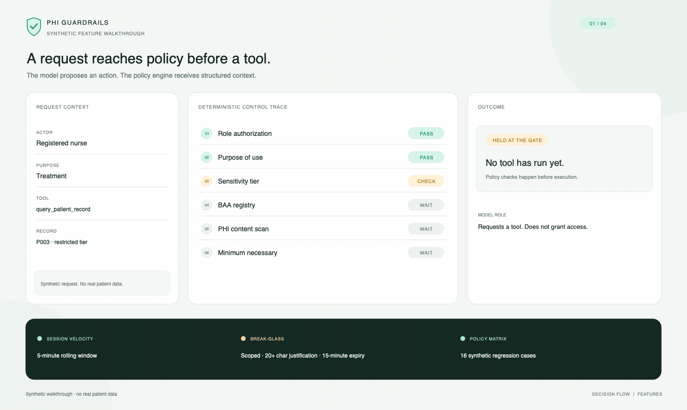
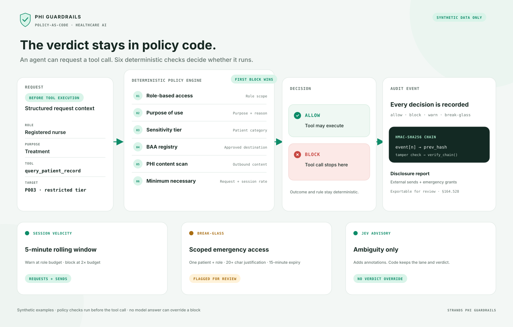

# Strands PHI Guardrails Demo

[](https://github.com/itsnmills/Strands-PHI-Guardrails-Demo/actions/workflows/ci.yml)
[](https://github.com/itsnmills/Strands-PHI-Guardrails-Demo/actions/workflows/pages.yml)

**Live demo:** [itsnmills.github.io/Strands-PHI-Guardrails-Demo](https://itsnmills.github.io/Strands-PHI-Guardrails-Demo/). It runs entirely in the browser, and all the data is synthetic.

This is a demo of access controls for an AI agent working with patient data. Before the agent
can call a tool (look up a record, write a note, send something to a vendor), the request goes
through a set of policy checks written in ordinary Python. If a check fails, the tool call
doesn't happen, and the decision is written to an audit log.

The point is that the rules live in code, not in the system prompt. A prompt that tells the
model "don't share PHI" can be talked around. A check that looks at the user's role, the
patient record, and the destination before anything executes can't be, because it never
reads the prompt.



## What it checks

Every tool call goes through six checks in order. The first one that fails stops the request,
and the trace shows which check it was and why.

| # | Check | Example of a block | Code |
|---|-------|--------------------|------|
| 1 | Role-based access | IT admin has no PHI access; billing can't write clinical notes; nurses can't send to vendors | `app/policies/rbac.py` |
| 2 | Purpose of use | A researcher can't claim "treatment"; research access needs a written IRB justification | `app/policies/purpose_of_use.py` |
| 3 | Record sensitivity | Records are tagged standard, sensitive (substance use, 42 CFR Part 2), or restricted (psychiatric), and each role has its own limits | `app/data/patients.py` |
| 4 | BAA status | The vendor must match a registry of vendors with a signed BAA exactly. Typos, case changes, and subdomains fail. Consumer AI platforms are always blocked | `app/data/vendors.py` |
| 5 | PHI in outbound data | Pattern matching for SSNs, MRNs, DOBs, phone numbers, addresses, and so on. High-risk payloads to outside vendors are blocked | `app/guardrails/phi_detector.py` |
| 6 | Minimum necessary | Limits how much one request can pull, plus a per-session rate limit. A nurse pulling six records in quick succession gets stopped | `app/guardrails/session_monitor.py` |



The same checks are implemented twice:

- `app/guardrails/policy_engine.py` is the plain version, with no dependencies and no LLM. The tests, benchmarks, and offline mode use it.
- `app/guardrails/steering_handler.py` wraps the same checks as a Strands `SteeringHandler`, so the live agent hits them before every tool call.

### Session controls

- **Rate limiting per session.** A rolling 5-minute window warns when a user hits their record budget and blocks at twice the budget. This catches chart browsing and bulk pulls that look fine one request at a time.
- **Break-glass access.** This is the emergency override. It covers one patient and one role, requires a written reason of at least 20 characters, expires after 15 minutes, and logs a flagged event for review afterward.

### Audit log

Every decision (allow, block, warn, break-glass) is written to a hash-chained log
(`app/guardrails/audit_logger.py`). Each entry includes the previous entry's hash and an
HMAC-SHA256 over its own contents. If anyone edits, deletes, or reorders an entry,
`verify_chain()` reports where the chain breaks.

```json
{
  "event_id": "a1b2c3d4", "category": "POLICY_EVAL", "outcome": "BLOCKED",
  "policy_rule_triggered": "Sensitivity Tier: Access Denied",
  "prev_hash": "0f3e…", "entry_hash": "9a7b…"
}
```

The log also feeds an accounting-of-disclosures report (45 CFR §164.528) in
`app/compliance/disclosures.py`. It lists external vendor sends and break-glass grants, and
it's available as a panel and a CSV export in the Streamlit app.

In this demo the key is held in memory and the log only lasts for the session. A real
deployment would keep the key in a KMS or HSM and write the log to append-only storage.

## Optional model-based review (Jev)

The checks above are deterministic, and they settle almost every request. A few cases are
ambiguous: a tool name the policy doesn't recognize, a vendor that's in neither the approved
list nor the blocklist, or text that might contain PHI the patterns can't confirm. For those,
`app/jev/` can ask Jev, a small classification model from TypeSafe, narrow yes/no questions
such as "does this tool send data externally?"

The model's answer is only used to **annotate** the decision for a human reviewer. It can't
change the outcome. Whether a request is allowed or blocked is always decided by the Python
checks.

This design came out of testing. When the model was asked to judge whether requests were
legitimate, it second-guessed clear policy blocks and let some through. When it was limited
to the ambiguous cases, it escalated every blocked request and allowed none. The trial
scripts and results are in `trial/`.

Jev is off by default. Without network access, each check falls back to a regex version that
feeds the same logic, so CI runs the real code paths without a key. To turn it on:

```bash
JEV_ALLOW_NETWORK=1 streamlit run streamlit_app.py
```

## Testing

210 tests, all of which run without an LLM or API key:

```bash
pip install -r requirements.txt
python -m pytest -q tests
```

- **Policy cases** (`tests/test_evals.py`): 16 scenarios, each with an expected outcome and an expected rule.
- **Red team** (`tests/test_redteam.py`, `app/evals/redteam_cases.py`): 42 adversarial cases.
  - None of the 19 policy-bypass attempts got through (vendor name tricks, faked purpose of use, raw SSNs in outbound data, and so on).
  - Of the 12 prompt-injection cases, 5 were blocked because the underlying request broke policy. The other 7 made no difference, because the checks never read the prompt.
  - 10 cases are known gaps: encoded or obfuscated PHI (base64 SSNs, leetspeak, spelled-out dates) that regex can't catch. They're kept in the suite so the gaps stay visible.
  - 2 cases are former gaps that have since been fixed. They're kept as regression tests.
- **Property tests** (`tests/test_properties.py`, Hypothesis): 12 invariants, each checked against 200 generated inputs. Examples: decisions are deterministic, raw PHI never leaves, and unregistered vendors are never allowed.
- **Session, audit, and disclosure tests**: rate-limit escalation, break-glass scope and expiry, tamper detection on the audit chain, and the disclosure report.
- **Jev tests**: response parsing, fallback when the model is unreachable, that only identifiers are sent (never the payload), and that a model response never changes a decision.

### Performance

From `benchmarks/bench_guardrails.py` on Apple Silicon, with no LLM or network:

| Measurement | p50 | p99 |
|---|---|---|
| Six-check evaluation | 2.9 µs | 23.2 µs |
| Including rate limit and break-glass state | 4.5 µs | 23.8 µs |
| PHI scan | 6–15 µs | ≤ 20 µs |
| Writing one audit entry | 10.3 µs | 14.5 µs |
| Full pre-tool check on the live agent | 32.8 µs | 65.3 µs |

The checks add microseconds to each tool call, which is negligible next to a model call.
Verifying a 5,000-entry audit chain takes about 33 ms.

## Running it

**Browser version.** Open [`demo-ui.html`](demo-ui.html) directly, or serve the folder with
`python3 -m http.server 4173`. This is the version hosted on GitHub Pages. It's a JavaScript
port of the same six checks, with the test scenarios, a PHI highlighter, redaction previews,
and an exportable audit trail. You can link straight to a scenario, for example
`demo-ui.html?theme=dark&run=B2`.

**Live agent (Streamlit):**

```bash
pip install -r requirements.txt
cp .env.example .env        # add OPENCODE_API_KEY or OPENROUTER_API_KEY
streamlit run streamlit_app.py
```

The app talks to any OpenAI-compatible endpoint. The default is OpenCode Go
(`https://opencode.ai/zen/go/v1`, model `deepseek-v4.1-flash`). Set `PHI_DEMO_BASE_URL` or
`PHI_DEMO_MODEL` to use something else, or pick a model from the sidebar. Without a key, the
app runs in deterministic mode and every policy path still works.

You can also paste an API key in the sidebar. It's kept in memory for the session unless you
choose to save it to `.env`, which is gitignored and written with `0600` permissions. The app
only ever shows the last four characters and a hash of the key, and the key never appears in
logs, the audit trail, or exports.

The app shows each step as it happens: the model's output, the tool request, the policy
decision, and the tool result. It also has a button to verify the audit chain and a
break-glass control in the sidebar.

**Standalone HTTP check (`guardrails/`).** This is a separate, dependency-free copy of the
engine with a small FastAPI server (`guardrails/server.py`). Other services on the same host
can `POST /check` before making an external call. It listens on `127.0.0.1:8100` only, and a
systemd unit file is included.

## Limitations

- PHI detection is regex-based and misses encoded or obfuscated data. The red-team gaps above show exactly which cases. The fix would be an NER layer such as Presidio or Comprehend Medical, which isn't built yet.
- The audit key is in memory and the log only lasts for the session.
- Break-glass review stops at a queue count and flagged events. There's no reviewer interface.
- This isn't a production authorization system, HIPAA certification, or legal advice. It's a working example of where these checks belong in an AI workflow and what they should log.
